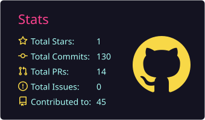
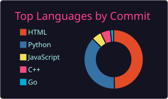

 

 

Second-year BTech IT student at VJTI, Mumbai. I like building things that are slightly too ambitious for my own good.

**Things I spend an unreasonable amount of time thinking about**

`AI / ML` · `distributed systems` · `cybersecurity` · `algorithms` · `databases` · `networks` · `open source` · `developer tools` · `"can this be automated?"`

---

## ⚡ Tech Stack

---

## 📊 GitHub Activity

---

## 🧃 Currently

* **building:** [CDCS](https://github.com/omisha123/CDCS), moving the storage layer into standalone processes
* **exploring:** AI/ML, distributed systems, cybersecurity, open source
* **debugging:** unfortunately

---

## 🪩 Fun Facts

* I will absolutely overcomplicate a simple idea if it makes it more interesting. Half of my ideas begin with **"okay hear me out"**.
* `works on my machine` is not a debugging strategy. *(it is, however, a temporary one.)*
* I treat every project as a main quest and every detour as a sidequest. The sidequests usually win.

---

## 📬 Connect

 

`if you're curious too, we're probably going to get along.`

